# Andrey Krokhin

I'm a second-year bachelor's student at MIPT, Department of Radio Engineering and Computer Technologies. I'm interested in systems programming, compiler technologies and program analysis.

## Selected projects

### C++

- [rank-queries-research](https://github.com/andreyphm/rank-queries-research): a research project comparing a sorted vector, std::set, an augmented AVL tree and a B-tree on rank queries over a dynamic set.
- [triangles](https://github.com/andreyphm/triangles): an OpenGL visualizer of 3D triangle intersections, detected with exact geometric predicates.
- [cache-research](https://github.com/andreyphm/cache-research): a research project on finding the optimal inclusive three-level cache system built from LFU, 2Q, ARC and LIRS caches.

### C

- [my-language](https://github.com/andreyphm/my-language): a compiler for a language with math-analysis-style syntax. It emits x86-64 NASM code or writes an ELF64 executable directly.
- [differentiator](https://github.com/andreyphm/differentiator): a symbolic differentiator with a recursive descent parser, simplification and PDF output via LaTeX.

## Contacts

- Email: [andrewkrokhin@gmail.com](mailto:andrewkrokhin@gmail.com)
- Telegram: [@andreyphm](https://t.me/andreyphm)
- CV: [pdf](https://github.com/andreyphm/andreyphm/blob/main/CV_KrokhinAA.pdf)

## Stats

  
 
  

